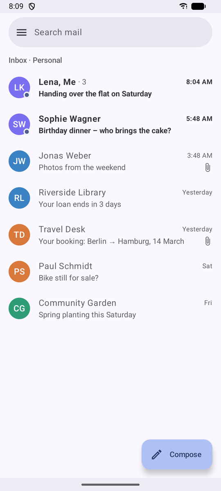
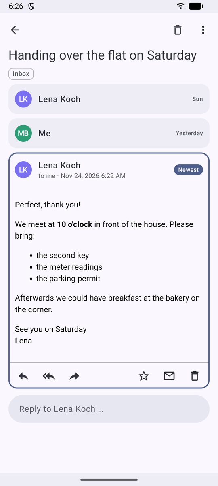
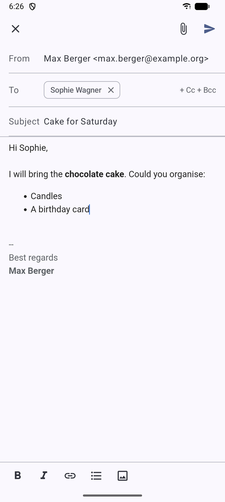
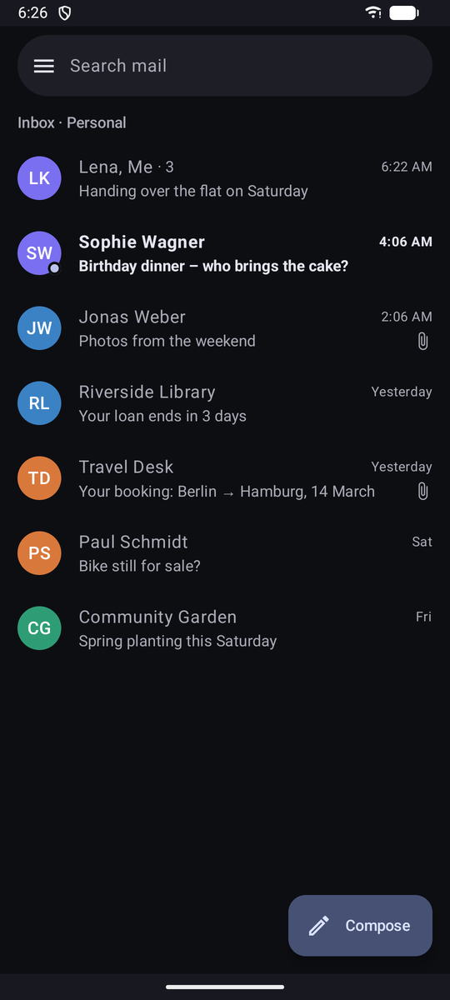
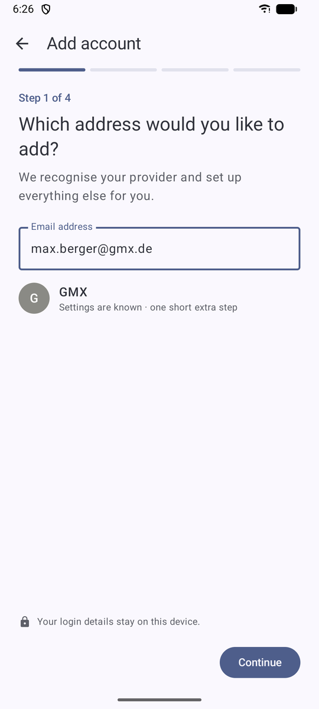
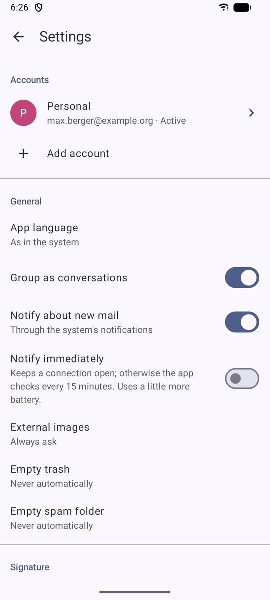
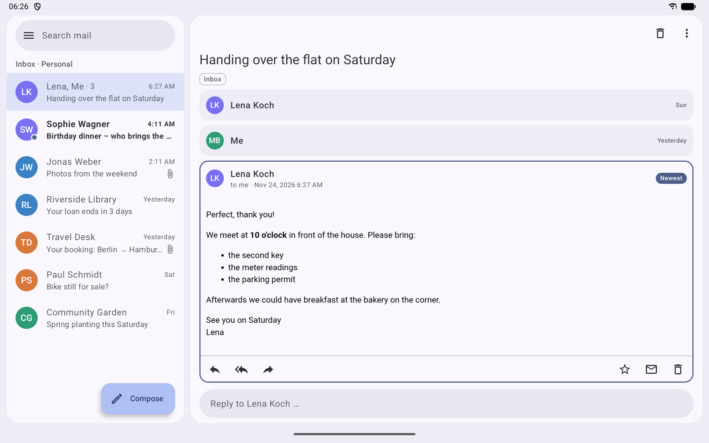

[English](README.md) · **Deutsch**


# E-Mail – die moderne E-Mail-App für Android

Eine einfache, moderne E-Mail-App für Android 12 und neuer, gemacht für Telefone, Tablets und Foldables, geschrieben in Kotlin mit Jetpack Compose und Material 3. Sie ist die Android-Fassung von [E-Mail für Linux](https://github.com/deviablo/email).

Mehrere Konten, IMAP und SMTP, sonst nichts: kein Kalender, kein Chat, keine Kontaktverwaltung.

**Aktuelle Version: 1.0.1**

<p>
  
  
  
  
</p>
<p>
  
  
</p>



## Funktionen

- **Mehrere Konten, strikt getrennt:** jedes Konto für sich, ohne gemeinsamen Posteingang. Die geführte Einrichtung erkennt den Anbieter, findet die Servereinstellungen und hilft bei App-Passwörtern.
- **Unterhaltungen:** Antworten stehen direkt unter der Nachricht, es ist immer genau eine Nachricht aufgeklappt, die neueste ist hervorgehoben. Wischen markiert als gelesen oder löscht, mit „Rückgängig“.
- **Schreiben:** Formatierung, Bilder im Text, Anhänge, Cc und Bcc und eine Signatur pro Konto. Entwürfe werden automatisch gespeichert, und was ohne Internet geschrieben wird, geht raus, sobald die Verbindung wieder steht.
- **Suche** im ganzen Konto mit Filtern, auch auf dem Server.
- **Benachrichtigungen über das System,** auf Wunsch pro Konto, mit „Als gelesen markieren“ und „Löschen“. Die App schaut alle 15 Minuten nach; mit „Sofort benachrichtigen“ hält sie eine Verbindung offen und meldet neue Mails nach wenigen Sekunden.
- **Telefon, Tablet und Foldable:** Auf breiten Bildschirmen stehen Liste und Unterhaltung nebeneinander, neue Mails öffnen sich in einem eigenen Fenster. Auf Foldables wie dem Pixel Fold nutzt die App das Außendisplay wie ein Telefon und das aufgeklappte Innendisplay wie ein Tablet; beim Auf- und Zuklappen bleibt alles, wo es war, auch eine angefangene Mail. Drucken über den Dialog des Systems.
- **Privat:** Externe Bilder werden erst nach Freigabe geladen, Passwörter liegen verschlüsselt im Android-Schlüsselspeicher und verlassen das Gerät nur zur Anmeldung, keine Cloud-Sicherung.
- **Sprachen:** Deutsch und Englisch.

Unterstützt werden alle Anbieter mit IMAP und SMTP, zum Beispiel Gmail, GMX, WEB.DE, iCloud, Yahoo, Posteo, mailbox.org und die meisten Firmen- und Hostingpostfächer. Microsoft-Konten (Outlook, Hotmail, Office 365) werden nicht unterstützt, weil Microsoft Mail-Apps die Anmeldung mit Passwort nicht mehr erlaubt.

## Installieren

Die App gibt es nicht im Play Store; jede Version liegt unter [Releases](https://github.com/deviablo/email-android/releases/latest) als APK-Datei. Sie läuft ab Android 12.

1. [Releases](https://github.com/deviablo/email-android/releases/latest) auf dem Telefon öffnen und `e-mail-1.0.1.apk` herunterladen.
2. Die heruntergeladene Datei öffnen, zum Beispiel über die Download-Benachrichtigung des Browsers.
3. Android fragt einmal, ob der Browser Apps installieren darf. Auf „Einstellungen“ tippen, „Unbekannte Apps installieren“ erlauben und zurückgehen.
4. Auf „Installieren“ tippen. Meldet Google Play Protect, dass die App unbekannt ist: „Weitere Details“ und dann „Trotzdem installieren“ wählen. Die App ist einfach nicht im Play Store.

Danach erscheint „E-Mail“ bei deinen Apps. **Updates** installierst du genauso, direkt über die vorhandene App; Konten und Mails bleiben erhalten.

Zu jeder Version gibt es außerdem eine `.sha256`-Datei mit der Prüfsumme der APK, falls du den Download überprüfen möchtest.

### Tipp zum Ausprobieren

Richte zuerst ein Testkonto ein, nicht gleich dein wichtigstes Postfach. Für Gmail, iCloud und Yahoo brauchst du ein App-Passwort, bei GMX und WEB.DE muss IMAP einmal im Webmailer eingeschaltet werden. Die Einrichtung erklärt beides Schritt für Schritt.

### Deinstallieren

Lange auf das App-Symbol tippen und „Deinstallieren“ wählen, oder Einstellungen → Apps → E-Mail → „Deinstallieren“. Deine Mails bleiben auf dem Server; nur die Kopie auf dem Telefon wird entfernt.

## Selbst bauen

Du brauchst ein JDK 21 (das von Android Studio genügt) und das Android-SDK.

```bash
./gradlew testDebugUnitTest lintDebug
```

```bash
./gradlew assembleDebug
```

Die APK liegt dann in `app/build/outputs/apk/debug/`. Debug-Builds vertrauen dem Testzertifikat in `app/src/debug/res/raw/test_ca.pem` und können so mit dem lokalen Testserver sprechen:

```bash
build-aux/test-mail-server.sh
```

Das startet [GreenMail](https://greenmail-mail-test.github.io/greenmail/) auf deinem Rechner mit ein paar Beispiel-Mails (IMAP 3993, SMTP 3465, Benutzer `max.berger@example.org` und `lena.koch@example.org`, Passwort `secret`) und leitet die Ports in einen laufenden Emulator weiter. In der App „Server selbst eintragen“ wählen: `127.0.0.1`, SSL/TLS.

Veröffentlichungen baut GitHub Actions (`.github/workflows/build.yml`), sobald ein Tag `v*` hochgeladen wird; der Signaturschlüssel kommt aus den Secrets des Repositorys.

## Mitmachen

Fehler und Ideen bitte als [Issue](https://github.com/deviablo/email-android/issues) melden.

## Lizenz

E-Mail ist ein offenes Gemeinschaftsprojekt, unterstützt von der [DIGISTALTER GmbH](https://www.digistalter.de).

Dieses Programm ist freie Software: Du kannst es unter den Bedingungen der GNU General Public License, wie von der Free Software Foundation veröffentlicht, weitergeben und/oder verändern, entweder gemäß Version 3 der Lizenz oder (nach deiner Wahl) jeder späteren Version.

Dieses Programm wird in der Hoffnung verbreitet, dass es nützlich ist, aber **ohne jede Gewährleistung**; sogar ohne die stillschweigende Gewährleistung der Marktgängigkeit oder der Eignung für einen bestimmten Zweck. Einzelheiten stehen in der GNU General Public License.

Den vollständigen Lizenztext findest du in der Datei [`LICENSE`](LICENSE).

`SPDX-License-Identifier: GPL-3.0-or-later`
