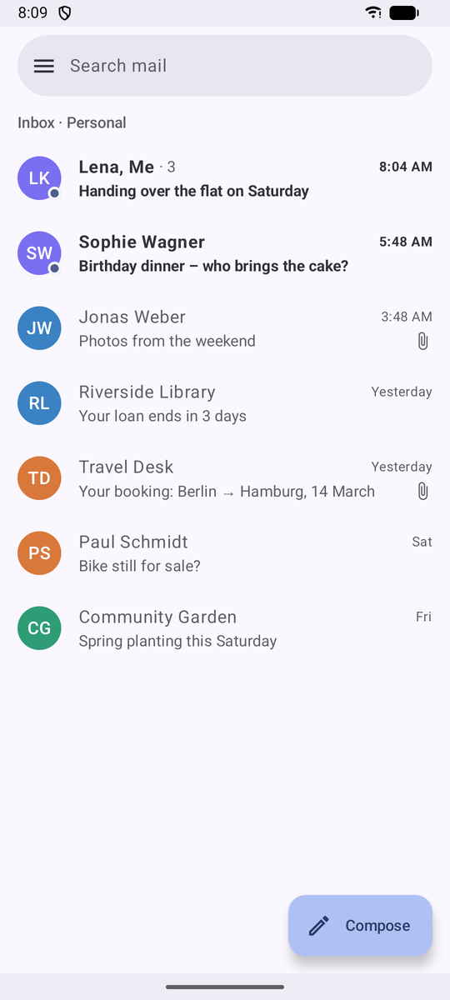
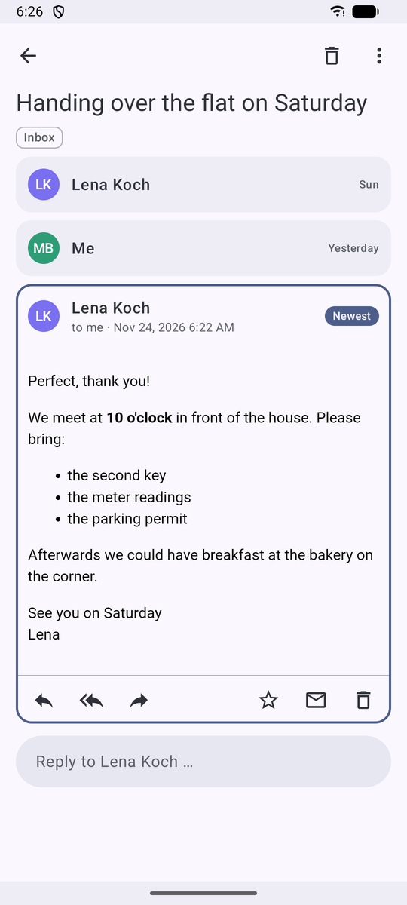
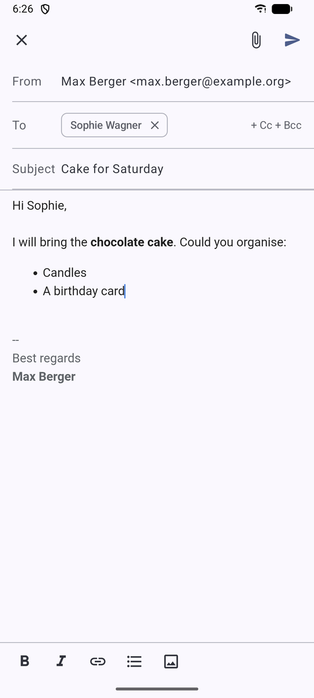
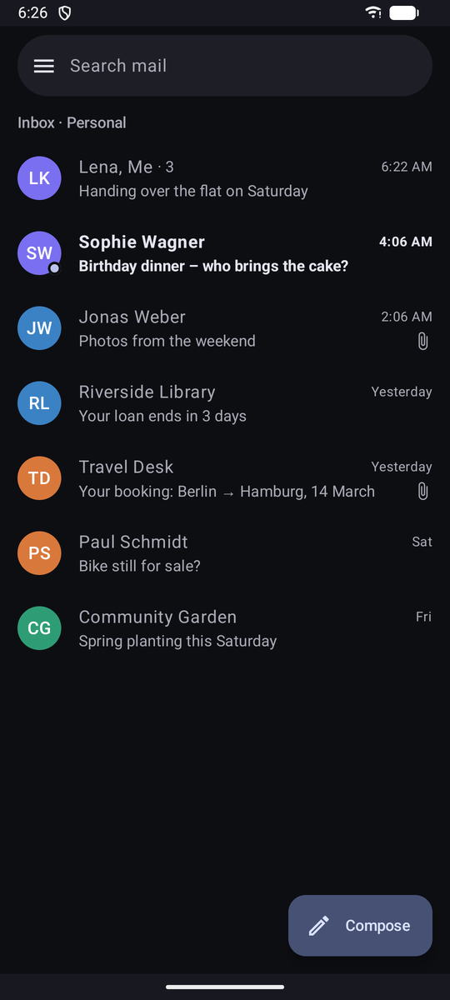
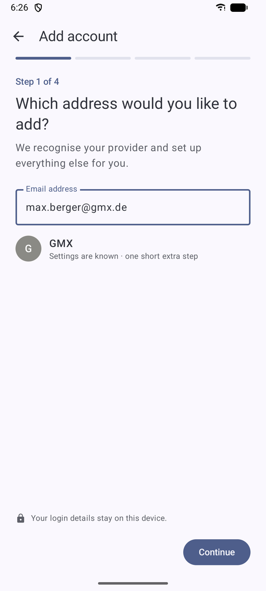
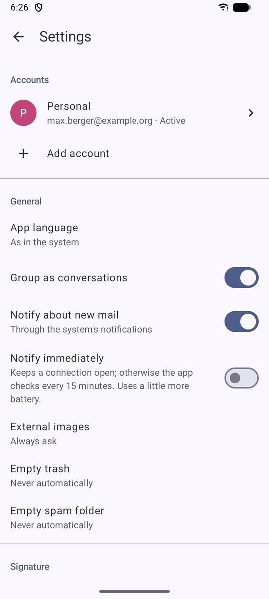
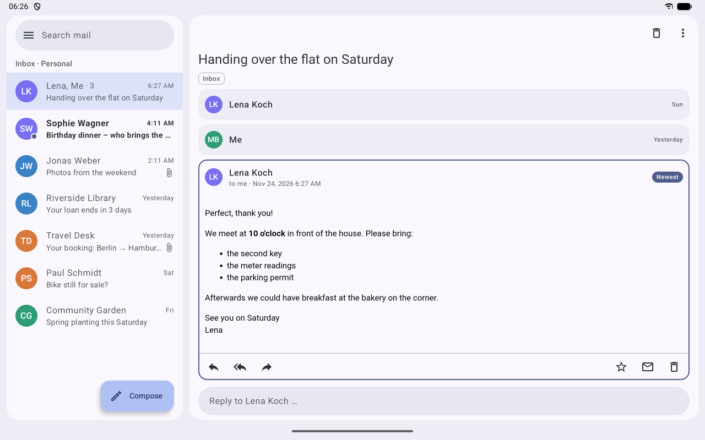

**English** · [Deutsch](README.de.md)


# E-Mail – the modern email app for Android

A simple, modern email app for Android 12 and newer, made for phones, tablets and foldables, written in Kotlin with Jetpack Compose and Material 3. It is the Android version of [E-Mail for Linux](https://github.com/digistalter/email).

Several accounts, IMAP and SMTP, nothing else: no calendar, no chat, no contact management.

**Current version: 1.0.2**

<p>
  
  
  
  
</p>
<p>
  
  
</p>



## Features

- **Several accounts, strictly separate:** every account on its own, without a shared inbox. The guided setup recognises your provider, finds the server settings and helps with app passwords.
- **Conversations:** replies sit right below the message, exactly one message is open at a time and the newest one stands out. Swipe to mark as read or to delete, with “Undo”.
- **Writing:** formatting, pictures in the text, attachments, Cc and Bcc, and one signature per account. Drafts are saved automatically, and what you write while offline is sent as soon as you are connected again.
- **Search** across the whole account with filters, also on the server.
- **Notifications through the system,** per account if you like, with “Mark as read” and “Delete”. The app checks every 15 minutes; with “Notify immediately” it keeps a connection open and reports new mail within seconds.
- **Phone, tablet and foldable:** on wide screens the list and the conversation sit side by side, new messages open in their own window. On foldables such as the Pixel Fold the app uses the cover screen like a phone and the unfolded inner screen like a tablet; folding and unfolding keeps your place, even in a message you are writing. Printing through the system dialog.
- **Private:** external images load only after you allow them, passwords are encrypted with the Android Keystore and leave the device only to sign in, no cloud backup.
- **Languages:** English and German.

Every provider with IMAP and SMTP works, for example Gmail, GMX, WEB.DE, iCloud, Yahoo, Posteo, mailbox.org and most company and hosting mailboxes. Microsoft accounts (Outlook, Hotmail, Office 365) are not supported, because Microsoft no longer lets mail apps sign in with a password.

## Install

The app is not in the Play Store; every version is under [Releases](https://github.com/digistalter/email-android/releases/latest) as an APK file. It runs on Android 12 and newer.

1. Open [Releases](https://github.com/digistalter/email-android/releases/latest) on your phone and download `e-mail-1.0.2.apk`.
2. Open the downloaded file, for example from the browser's download notification.
3. Android asks once whether your browser may install apps. Tap “Settings”, allow “Install unknown apps” and go back.
4. Tap “Install”. If Google Play Protect says the app is unknown, tap “More details” and then “Install anyway”: the app is simply not in the Play Store.

“E-Mail” then shows up among your apps. **Updates** are installed the same way, right over the existing app; your accounts and mail stay.

**Coming from version 1.0.0 or 1.0.1?** Since 1.0.2 the app has a new ID, so Android installs it as a separate app. Uninstall the old “E-Mail” and set up your accounts again in the new one; your mail stays on the server.

Each release also has a `.sha256` file with the checksum of the APK, for anyone who wants to verify the download.

### Tip for trying it out

Set up a test account first, not your most important mailbox. For Gmail, iCloud and Yahoo you need an app password; for GMX and WEB.DE, IMAP has to be switched on once in the provider's web mail. The setup explains both step by step.

### Uninstall

Long-press the app icon, then “Uninstall”, or Settings → Apps → E-Mail → “Uninstall”. Your mail stays on the server; only the copy on the phone is removed.

## Build it yourself

You need a JDK 21 (the one in Android Studio works) and the Android SDK.

```bash
./gradlew testDebugUnitTest lintDebug
```

```bash
./gradlew assembleDebug
```

The APK is then in `app/build/outputs/apk/debug/`. Debug builds trust the test certificate in `app/src/debug/res/raw/test_ca.pem`, so they can talk to the local test server:

```bash
build-aux/test-mail-server.sh
```

It starts [GreenMail](https://greenmail-mail-test.github.io/greenmail/) on your computer with a few sample mails (IMAP 3993, SMTP 3465, users `max.berger@example.org` and `lena.koch@example.org`, password `secret`) and forwards the ports into a running emulator. In the app, choose “Enter servers yourself”: `127.0.0.1`, SSL/TLS.

Releases are built by GitHub Actions (`.github/workflows/build.yml`) when a tag `v*` is pushed; the signing key comes from the repository secrets.

## Contributing

Please report bugs and ideas as an [issue](https://github.com/digistalter/email-android/issues).

## License

E-Mail is an open community sponsored by [DIGISTALTER GmbH](https://www.digistalter.de).

This program is free software: you can redistribute it and/or modify it under the terms of the GNU General Public License as published by the Free Software Foundation, either version 3 of the License, or (at your option) any later version.

This program is distributed in the hope that it will be useful, but **without any warranty**; without even the implied warranty of merchantability or fitness for a particular purpose. See the GNU General Public License for more details.

The full license text is in the file [`LICENSE`](LICENSE).

`SPDX-License-Identifier: GPL-3.0-or-later`
